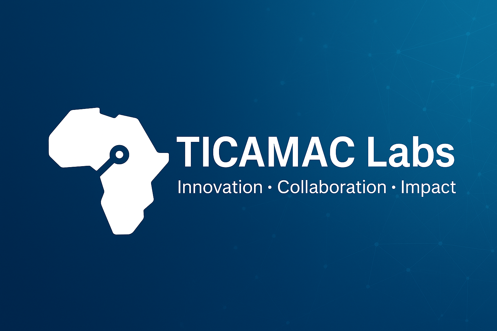

# TICAMAC GROUP
### Technological Innovation Center for Africa

**BUILDING A SMARTER TOMORROW**

Technologie · Innovation · Formation · Transformation numérique

**Construire des solutions technologiques utiles, durables et adaptées aux réalités africaines.**

*Building practical, sustainable technology for Africa and beyond.*

[Site institutionnel](https://ticamac.com) · [TICAMAC Academy](https://academy.ticamac.com) · [Nous contacter](mailto:contact@ticamac.com)

---

## Notre identité

**TICAMAC** signifie **Technological Innovation Center for Africa**.

**TICAMAC Group** est un groupe technologique d'origine camerounaise dont l'ambition est de développer un écosystème intégré de solutions numériques, de formation, de recherche appliquée et de services technologiques.

Cette organisation GitHub, **TICAMAC-Labs**, constitue un espace de travail de son écosystème d'ingénierie : architecture logicielle, expérimentation, conception de produits, documentation technique et collaboration sur les projets autorisés.

Notre démarche repose sur une conviction : **la transformation numérique doit répondre à des besoins concrets, renforcer les compétences locales et créer de la valeur à long terme.**

## Notre écosystème

| Pôle | Vocation |
| --- | --- |
| **TICAMAC Group** | Vision, orientation stratégique et développement de l'écosystème. |
| **TICAMAC Software** | Conception et développement de solutions logicielles et de plateformes numériques. |
| **TICAMAC Academy** | Formation, apprentissage pratique et développement des compétences technologiques. |
| **TICAMAC Hub** | Espace de collaboration, de formation et de services numériques de proximité ; offre en cours de structuration. |
| **TICAMAC Cloud** | Réflexion et développement progressif de capacités d'hébergement et d'infrastructure numérique. |
| **TICAMAC Labs** | Exploration technologique, recherche appliquée, prototypes et validation d'approches innovantes. |
| **TICAMAC Ventures** | Perspective de soutien et de développement de nouvelles initiatives entrepreneuriales. |

> **Transparence institutionnelle :** ces pôles représentent l'organisation et la feuille de route du groupe. Leur présentation ne signifie pas que chaque activité, infrastructure ou service est déjà commercialement opérationnel.

## Nos axes technologiques

- **Ingénierie logicielle :** plateformes web, applications métiers, conception de systèmes et intégrations.
- **Intelligence artificielle et données :** études de cas, automatisation responsable, analyse et outils d'aide à la décision.
- **Infrastructures et cybersécurité :** réseaux, systèmes, pratiques de sécurité et résilience des services.
- **Cloud et souveraineté numérique :** architectures d'hébergement et de gestion des données adaptées aux contraintes locales.
- **Systèmes connectés et technologies émergentes :** Internet des objets, prototypage, fabrication numérique et sujets de recherche appliquée.
- **Transmission des compétences :** formation pratique, documentation, partage des méthodes et apprentissage continu.

Ces axes décrivent nos **domaines de travail et d'intérêt**, sans constituer une annonce de produits achevés ou de capacités certifiées.

## Nos principes d'ingénierie

**Utilité réelle.** Partir des besoins des utilisateurs et des organisations.

**Sécurité et confidentialité.** Intégrer la protection des données et le contrôle des accès dès la conception.

**Qualité et traçabilité.** Documenter les décisions techniques, vérifier les changements et conserver des preuves de validation.

**Accessibilité et sobriété.** Concevoir des solutions utilisables, y compris dans des environnements où la connectivité et les ressources sont limitées.

**Responsabilité.** Distinguer les travaux exploratoires, les prototypes, les livraisons vérifiées et les services effectivement disponibles.

## Collaboration et projets

Nos dépôts peuvent être publics ou privés selon la sensibilité des travaux, les obligations contractuelles et leur niveau de maturité. **L'absence de publication publique ne signifie pas l'absence de travail**, et la présence d'un dépôt ne vaut pas annonce officielle de disponibilité d'un produit.

Les contributions, partenariats techniques et publications sont organisés dans le cadre des autorisations et procédures propres à chaque projet.

## Présence et contact

**Ancrage :** Douala, Cameroun  
**Perspective :** Afrique, collaborations internationales  
**Site :** [ticamac.com](https://ticamac.com)  
**Formation :** [academy.ticamac.com](https://academy.ticamac.com)  
**Contact général :** [contact@ticamac.com](mailto:contact@ticamac.com)

---

## International overview

**TICAMAC** stands for **Technological Innovation Center for Africa**. Our signature is **BUILDING A SMARTER TOMORROW**.

**TICAMAC Group** is a Cameroon-rooted technology group developing an integrated ecosystem spanning software engineering, digital skills, applied innovation, infrastructure and technology-enabled services.

**TICAMAC-Labs** is a collaborative engineering and experimentation space within this ecosystem. We focus on practical use cases, secure and maintainable systems, accessible technology and long-term local capacity building.

Our areas of interest include **software development, AI and data, cybersecurity, cloud infrastructure, connected systems and applied prototyping**. Some initiatives are exploratory or under development; their inclusion here does not imply commercial availability.

**Connect with us:** [Official website](https://ticamac.com) · [Academy](https://academy.ticamac.com) · [Email](mailto:contact@ticamac.com)

---

**TICAMAC GROUP**  
**BUILDING A SMARTER TOMORROW**

